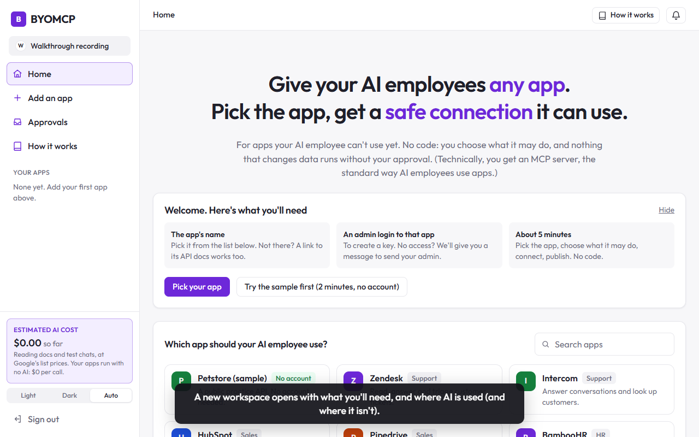
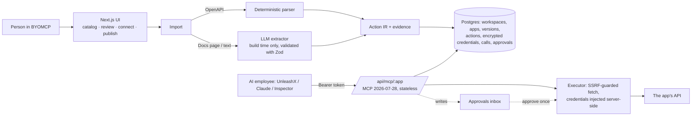

# BYOMCP

**Give your AI employees any app.** Pick the app (or paste a link to its API docs), choose what your AI employee may do, connect your account, and get a safe, working [MCP](https://modelcontextprotocol.io) server. No code, and nothing that changes data runs without a person approving it.

[](https://github.com/alphaahad/byomcp/actions/workflows/ci.yml)

| | |
|---|---|
| **Live app** | https://byomcp.vercel.app (each reviewer gets their own passcode and workspace) |
| **Walkthrough video** | [docs/media/walkthrough.mp4](docs/media/walkthrough.mp4): a narrated, captioned 3-minute tour, recorded on the live site |
| **Built for** | UnleashX: its AI employees act through MCP "apps", and every app without one is engineering work today |

[](docs/media/walkthrough.mp4)

---

## Contents

[The problem](#the-problem) · [Try it in 3 minutes](#try-it-in-3-minutes) · [What it does](#what-it-does) · [Where AI is used (and where it isn't)](#where-ai-is-used-and-where-it-isnt) · [Architecture](#architecture) · [Key decisions](#key-decisions) · [Security](#security) · [Quality](#quality-and-testing) · [Limitations](#known-limitations) · [What's next](#whats-next) · [Run it locally](#run-it-locally) · [Docs](#docs)

## The problem

AI employees act through apps. A platform can ship dozens of MCP integrations, and there will still be a long tail: the niche helpdesk, the HR tool, the in-house API. Each one is engineering work, so it waits.

The people who feel that gap are in CS and ops. They know the app and have an account, but not what an API, a bearer token or `{subdomain}` means. BYOMCP lets **that person** close the gap safely, from the app's own docs, and lets the platform team turn the same tool into a catalog.

**Core principle: AI at build time, deterministic at runtime.** AI reads the docs once to draft the actions. A person reviews them. The published MCP server then runs stored definitions, with **no AI and $0 per call**.

## Try it in 3 minutes

1. Open https://byomcp.vercel.app and sign in with the passcode you were sent. Each passcode opens its own empty workspace.
2. **Try the sample first** (no account needed). It imports a public API and connects it. BYOMCP runs a safe read straight away, so the action is already marked Tested.
3. Under **What should your AI employee do?**, tick **Browse the pet shop** and **Add new pets**, then **Turn these on**.
4. **Publish** tab: you get an MCP address and a token (shown once). **Copy setup**, plus three steps for UnleashX.
5. **Test console → Talk to it**: ask *"Which pets are available?"* and watch an AI employee pick the tool and answer from the data. Then ask it to *add a pet*: it stops at **waiting for approval**.
6. **Approvals**: the request in plain words with the exact payload. **Approve and run** runs it exactly once.

Then try a real catalog app, such as **Zendesk**: 675 actions read with no AI, picked by job, with guided key setup.

## What it does

| Step | What the user sees | Screens |
|---|---|---|
| **Pick the app** | A searchable catalog of 27 verified apps (Zendesk, Freshdesk, WhatsApp via GREEN-API, Kaleyra SMS, Intercom, HubSpot, Pipedrive, Close, Apollo, Instantly, Asana, Jira, Notion, Mailchimp, Stripe, Razorpay, Databricks and more, plus a sample), or any docs link, OpenAPI file or pasted docs text. Missing an app? *"Tell us which app."* | [Home](docs/media/01-home.png) |
| **Choose what it can do** | Jobs, not endpoints: *"Answer customer tickets"* turns on exactly those actions. Every action shows its risk (Read / Changes data / Destructive) and its evidence (From the docs, with a quote / Tested / Needs review). | [Jobs](docs/media/02-jobs.png) |
| **Connect** | Step-by-step "where to find your key" for each app, what every field means, a message to send your admin, and **Save and check**, which runs a safe read: *"✓ Connected and working: we got back 60 records"*. Zendesk also has **Connect with Zendesk** (OAuth). | [Connect](docs/media/03-connect.png) |
| **Publish** | A versioned MCP server (spec 2026-07-28): **Copy setup**, three steps for UnleashX, and a ready message for whoever manages it. Edits go into a draft; live tools never change under an AI employee. | [Publish](docs/media/04-publish.png) |
| **Test** | **Talk to it** (an AI employee using the real tools, with every step shown) and a form-based console; raw MCP messages are there for engineers. | [Talk to it](docs/media/05-talk.png) |
| **Stay in control** | An approvals inbox (runs exactly once, expires after 24 hours, optional email alerts), an activity log with secrets hidden, health with "Needs reconnect", and a Setup panel on every page that always shows the next step. | [Approvals](docs/media/06-approvals.png) · [Activity](docs/media/07-activity.png) |

Around that: **one workspace per passcode** (the owner gets a Usage page across all workspaces, with a drill-down per workspace, and can revoke any of them), Light/Dark/Auto themes, phone layouts, and keyboard and screen-reader support.

## Where AI is used (and where it isn't)

| Step | AI? | Cost |
|---|---|---|
| OpenAPI file (every catalog app except BambooHR, Typeform and Razorpay) | **No.** A deterministic parser. | $0 |
| Docs page or pasted text | **Yes, once.** It extracts actions with a quote from the docs for each; quotes are checked against the text. | Under a cent per import, shown live (measured: $0.0040 on BambooHR) |
| Review, connect, test, publish, approvals | No | $0 |
| **Running the MCP server** (every call your AI employee makes) | **Never** | **$0 per call** |
| Optional **Talk to it** test chat | Yes, per test message (opt-in, with a notice about what's sent) | Shown per message |

Costs are estimates at Google's list prices and are shown in the app. The model is Gemini behind a provider interface (`LLM_PROVIDER`, `LLM_MODEL`), so Claude can be swapped in.

## Architecture



- **One generic runtime** reads stored, reviewed definitions. There's no code generation per connector, so there's one thing to secure, version and update.
- **MCP:** the official TypeScript SDK v2 with `mcp-handler`, on spec 2026-07-28 (stateless, `server/discover`), with a fallback for 2025-era clients. Checked live with the official SDK client in both modes and with MCP Inspector.
- More detail, with request flows for every slice: [docs/ARCHITECTURE.md](docs/ARCHITECTURE.md).

## Key decisions

The full log, with what was rejected and why, is in [docs/DECISIONS.md](docs/DECISIONS.md). The ones that matter most:

1. **AI at build time, deterministic at runtime.** AI is only used where the input varies and the output can be verified (docs → actions). Runtime cost is zero and behaviour is predictable.
2. **Evidence over confidence.** Every AI-drafted action carries a docs quote, checked against the text we sent; if the quote can't be found, the action is marked *Needs review*. A successful real call marks it *Tested*.
3. **Safe by default.** Writes start off. Destructive actions always need approval, enforced in the runtime and not just the UI. Approval is an atomic claim, so it runs exactly once even if two people click.
4. **Start from the app's name.** Non-technical users don't know where API docs live, so the catalog does. Every catalog entry must pass a real import in the integration tests before it ships.
5. **Jobs, not endpoints.** Zendesk has 675 actions; models choose badly from hundreds of tools, and people can't review them. Large APIs start with nothing on, and jobs turn on exactly what's needed.
6. **Save = check.** Connecting runs a safe read immediately, so "is it working?" is answered at the moment people care.
7. **One workspace per passcode.** Reviewers don't see each other's data, and the owner sees per-person usage. The isolation boundary is a single set of ownership checks, with an integration test.
8. **Honest limits are written down:** the test chat is the one place app data reaches the AI, which is why it's opt-in and labelled. Zendesk OAuth works for the registered account only. Free-tier email delivers only to the owner until a domain is verified.

## Security

Designed in from the first slice, then checked by an independent full-code review before the repo went public (all findings fixed; see DECISIONS).

- **Credentials:** AES-256-GCM, with the app's ID as associated data, so a ciphertext can't be moved to another app. They're decrypted only in memory, for one request. They're never logged, never returned to the browser after saving, and never sent to the AI. A saved key is never sent to a new host: changing the server address requires entering it again.
- **Outbound requests (SSRF):** https only. Private, link-local, IPv6-mapped, NAT64, 6to4 and Teredo addresses are blocked, and the IP is checked at connect time, which also defeats DNS rebinding. Every redirect is re-checked, credentials are dropped when a redirect crosses hosts, and size and time limits apply. Path values can't escape the app's base path.
- **Untrusted docs:** doc content is treated as data, never instructions. All LLM output is validated with Zod; risk comes from rules, never from the model.
- **Access:**
  - **Workspaces:** each passcode opens one workspace. Every page, action and route checks that the app belongs to the signed-in workspace; another workspace's app gets the same answer as a missing one.
  - **Passcodes and sign-in:** guest passcodes have 100 random bits and are stored as hashes. Failed sign-ins are rate-limited per client.
  - **Session cookie:** HMAC-signed and httpOnly, and it names its workspace. Revoking a workspace signs it out and stops its MCP servers.
- **MCP tokens:** random, shown once, stored as SHA-256 hashes, rotatable, one per app. Putting the token in the URL is opt-in and labelled less secure. There's a per-app call-rate limit and a cap on pending approvals.
- **Abuse limits for a public demo:** guests get AI imports (20 a day), test messages (30 a day) and apps (25), enforced in a way that parallel requests can't bypass.
- **Headers:** a CSP with `frame-ancestors 'none'`, `X-Frame-Options: DENY`, `nosniff`, `Referrer-Policy: no-referrer` and HSTS.
- **OAuth (Zendesk):** PKCE (S256) plus a client secret. The state is signed, expires, and is tied to the workspace and the app. Rotating refresh tokens are handled safely even when requests race.

## Quality and testing

- **195 unit tests** cover the OpenAPI mapping (Swagger 2, OpenAPI 3.0 and 3.1), AI extraction including prompt-injection cases, the executor and SSRF guard, sessions, OAuth state and PKCE, the chat loop, result shaping, the catalog and jobs, and approval emails.
- **Integration tests** in 11 suites (opt-in: real network, database and AI):
  - Every catalog app is imported for real, and every job is checked to match its actions.
  - MCP is called in-process, with the official SDK client, and with MCP Inspector against the live URL.
  - Approvals race tests check that a request runs exactly once.
  - Workspace isolation is tested.
  - The chat answers a read and parks a write in approvals.
- **CI** runs typecheck, lint and unit tests on every push ([workflow](.github/workflows/ci.yml)).
- **QA log:** end-to-end passes on desktop, tablet and phone, light and dark, and keyboard, with every defect found and fixed recorded in [docs/QA.md](docs/QA.md).

## Known limitations

- **Accounts:** sign-in is by passcode, one workspace each. There are no user accounts, teams or roles (who may publish or approve) yet.
- **OAuth:** "Connect with Zendesk" works for the Zendesk account the OAuth client is registered in. Other accounts use guided API tokens until Zendesk approves a global client. Other providers aren't wired yet; the provider definition is reusable.
- **Catalog:** 27 apps plus the sample, chosen to show the pipeline across many API styles. Most also appear in UnleashX's own docs; Zendesk, BambooHR and Kaleyra don't. Stripe, Mailchimp and Instantly use trimmed copies of their official specs (over or at the 5 MB limit); Freshdesk, WooCommerce, Databricks, GREEN-API and Kaleyra publish no usable OpenAPI file, so BYOMCP serves a small one written from their docs (labelled as such). GREEN-API's token lives in the URL path: the runtime fills it in and hides it from the AI employee and the logs. Not yet: monday.com (GraphQL only). Google, Microsoft, Meta, Zoho and other OAuth-only apps need BYOMCP registered and approved with each vendor.
- **Email alerts:** need a Resend key, and a verified domain to reach anyone other than the owner.
- **Not built:** event triggers or webhooks, connector sharing across workspaces, re-import diffs, PDF import, GraphQL and SOAP.

## What's next

- **Triggers:** let an app's events start an AI employee's work, not just answer its calls.
- **More OAuth providers**, using the same refresh-safe pattern as Zendesk.
- **Catalog sharing:** a reviewed, tested connector becomes a template for every workspace.
- **Accounts, teams and roles:** who can publish, who can approve, and an audit trail per person.
- **Re-import with a diff,** so changes to an API are reviewed before they go live.

## Run it locally

Requirements: Node 24 and a Postgres database (Neon works). A Gemini API key is optional; without it, AI import and the test chat are off.

```bash
npm install
cp .env.example .env.local   # fill in DATABASE_URL, APP_PASSCODE, CREDENTIALS_ENCRYPTION_KEY, …
npm run db:migrate
npm run dev                  # http://localhost:3000
```

Generate `CREDENTIALS_ENCRYPTION_KEY` with `openssl rand -base64 32`. `APP_PASSCODE` opens the owner workspace.

| Command | What it does |
|---|---|
| `npm run check` | Typecheck, lint and unit tests (what CI runs) |
| `RUN_INTEGRATION=1 MCP_BASE_URL=<deployed URL> npx vitest run integration` | Integration suites: real network, database and AI. They clean up after themselves. |
| `node scripts/create-workspaces.mts 3` | Create guest workspaces. Passcodes go to a gitignored local file. |
| `BASE_URL=… DEMO_PASSCODE=… FFMPEG=… node scripts/record-walkthrough.mts` | Re-record the walkthrough video: Playwright drives Edge, Gemini text-to-speech narrates each caption, and ffmpeg mixes in the voice |

**Stack:**
- Next.js 16 (App Router, Cache Components) and TypeScript (strict)
- Tailwind 4
- Drizzle ORM with Neon Postgres
- MCP TypeScript SDK v2 with `mcp-handler`
- Gemini (`@google/genai`)
- Zod, Ajv and swagger-parser
- Vitest
- Vercel

```
src/
  app/          pages, server actions, API routes (/api/mcp, /api/oauth, /api/imports)
  components/   UI kit, app shell, result view, schema forms
  lib/          shared, pure: Action IR, catalog, result shaping, best-read
  server/       server-only: auth, db, import, llm, mcp, runtime, notify, oauth, workspaces
drizzle/        SQL migrations
docs/           SPEC, ARCHITECTURE, DECISIONS, DESIGN, DEMO, QA, media/
scripts/        migrate, create workspaces, record the walkthrough
```

## Docs

- [docs/SPEC.md](docs/SPEC.md): the original brief, written before any code
- [docs/DECISIONS.md](docs/DECISIONS.md): every significant choice, why, and what was rejected
- [docs/ARCHITECTURE.md](docs/ARCHITECTURE.md): components, data model and request flows
- [docs/DESIGN.md](docs/DESIGN.md): the design language and how it was chosen
- [docs/DEMO.md](docs/DEMO.md): the live demo script
- [docs/QA.md](docs/QA.md): QA passes and the defect log

**How it was built:** a solo project over a few days, in vertical slices that were each type-checked, tested, committed and deployed. Claude Code was used as an AI pair programmer. Product, design and every decision above were reviewed and directed by me, and I can walk through any of them.

## License

**All rights reserved.** This repository is public for evaluation only. No one may copy, reuse, modify or distribute any of it without written permission. See [LICENSE](LICENSE).
