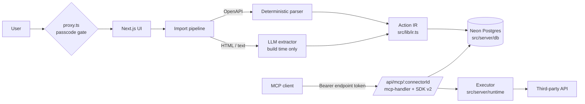
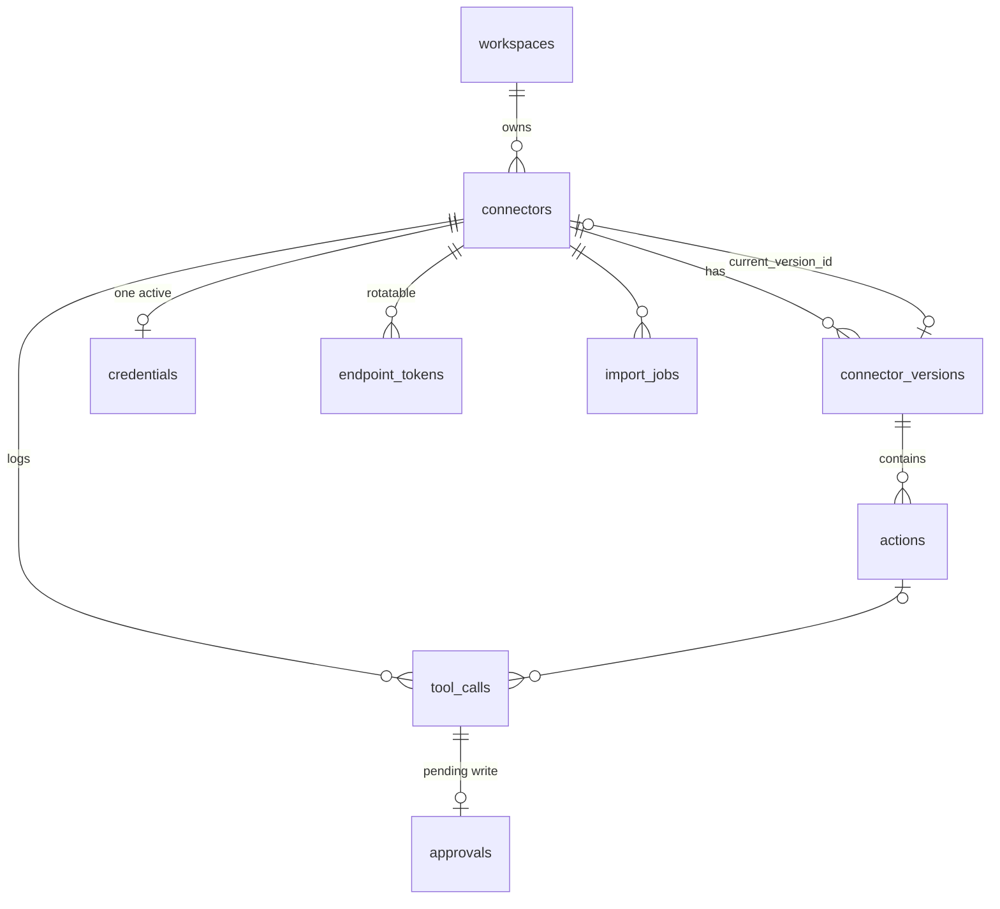

# Architecture

Status: first draft complete (slices 0–7). Everything below is built and live.

## Overview



## Code layout

| Path | What lives there |
|---|---|
| `src/app/` | Routes and pages (App Router). |
| `src/components/` | Shared UI: `app-shell` (sidebar + top bar), `app-tabs` (app header, tabs, Setup panel slot), `setup-panel`, `ui` (cards, tags, buttons), `icons`. |
| `src/lib/` | Code shared by server and client. `ir.ts` is the Action IR contract. |
| `src/server/` | Server-only code: `db/` (Drizzle schema + client), `auth/` (passcode session), `net/` (SSRF-guarded fetch), `import/` (OpenAPI and AI import → IR), `llm/` (provider interface, Gemini, prices), `connectors/` (queries, review rules, connection), `crypto/` (credential encryption), `runtime/` (executor, call log, Try it), `env.ts`. |
| `src/proxy.ts` | Passcode gate for every route except `/login`, `/api/mcp/*` and static files. |
| `drizzle/` | Generated SQL migrations. |
| `docs/` | SPEC, DESIGN, DECISIONS, this file. |

## Data model



- **workspaces**: one per passcode. The owner signs in with `APP_PASSCODE`; guests' passcodes are stored as SHA-256 hashes. Revoked workspaces can't sign in or stay signed in.
- **connectors**: one per app, in exactly one workspace (`workspace_id`); every other table is reached through an app, so that's the isolation boundary. Holds the confirmed `base_url`, auth type and where an API key goes.
- **connector_versions**: every import creates a draft version; publishing marks it published and points `connectors.current_version_id` at it. Stores AI cost and tokens per import.
- **actions**: the Action IR rows for a version, plus `enabled` and `requires_approval`. DB constraints enforce key format and "destructive always needs approval".
- **credentials**: AES-256-GCM ciphertext, IV and auth tag. Never returned to the browser; `hint` lets the UI say "key ending 3f9a".
- **endpoint_tokens**: SHA-256 hash of each MCP access token; the token is shown once.
- **tool_calls**: every call (MCP, Try it, approval) with redacted input, result class, HTTP status and a truncated preview.
- **approvals**: the exact input waiting for a human, with a plain-language summary.
- **import_jobs**: progress for the "Reading the docs" screen.

## Request auth

| Caller | Route | Check |
|---|---|---|
| Browser | everything except below | `proxy.ts` verifies the signed session cookie (it names the workspace); pages and server actions re-check with `requireWorkspace()` / `ownedConnector()`, which also refuse revoked workspaces |
| Browser | `/login` | open |
| MCP client | `/api/mcp/:id` | per-connector endpoint token (`withMcpAuth`, SHA-256 lookup) |
| MCP client | `/api/mcp/:id/k/:token` | same token in the URL, only if the app opted in |
| Test console | `/api/mcp/:id` | 10-minute HMAC console token, minted server-side for a signed-in user |

## Import pipeline (OpenAPI path)

```
URL ──safeFetch──┐                      (https only, IP checked at connect, 5 MB, 10 s, 3 redirects)
                 ├─ parseSpecText ─ swagger-parser (internal $refs only) ─ map ops → ActionIR ─ Zod ─┐
File upload ─────┘   (JSON/YAML, alias cap)                                                           │
                                                                                                      ▼
        one Neon batch: connectors + connector_versions(v1 draft, detected_json, skipped_json) + actions + import_jobs
```

- `src/server/import/openapi.ts`: pure mapping (no DB, no network); unit-tested on Swagger 2.0, OpenAPI 3.0 and 3.1 fixtures.
- `src/server/import/run-openapi-import.ts`: fetch or upload → map → save. Returns plain-language errors.
- `src/server/net/safe-fetch.ts`: the only outbound HTTP path; slice 2 (docs pages) and the runtime reuse it.

## Import pipeline (AI path: docs link or pasted text)

```
/apps/new ──► startAiImport: connector + draft v1 + import_jobs(stage=fetching|extracting) [+ import_chunks for pasted text]
                 │
/apps/import/:job (client) ── POST /api/imports/:job/step every ~0.6 s ──► stepAiImport (claims lease_until)
                 │
   fetching   : safeFetch start page → htmlToText → pick same-section links (neighbours first) → 4 pages/step
                 → chunkPages (~40k chars, segments keep URLs) → import_chunks
   extracting : ≤3 chunks/step in parallel → LLM (JSON schema) → parseExtraction (Zod) → toCandidates
                 (our risk rules, quote verified against the sent text, auth params dropped) → result_json, tokens, cost
   merging    : mergeCandidates (method + path shape) → voteDetected (base URL, auth) → one batch:
                 actions + version(cost, tokens, detected) + clear doc text + job done
```

- The LLM is called only here, once per import. Provider and model come from env (`LLM_PROVIDER`, `LLM_MODEL`, `LLM_FALLBACK_MODEL`); `src/server/llm/pricing.ts` holds the dated price table used for the cost estimate.
- `src/server/import/ai-extract.ts` is pure and unit-tested (including prompt-injection cases); `run-ai-import.ts` holds the step machine.

## Runtime executor (Try it, MCP and approvals)

```
flat input ── ajv (toolInputPlan schema) ── splitInput → path / query / headers / body
           ── buildRequest: encode path values, stay on base origin, block auth/hop headers & CRLF,
              add credentials last (decrypted in memory only)
           ── safeFetch (https, public IPs at connect time, 15 s, 2 MB, no redirects)
           ── classify: success | empty_or_invalid | auth_failed | transient_failed | request_error | validation_error
              (GETs retried ×2 on 429/5xx/timeouts; writes never auto-retried)
           ── scrub secrets from preview → tool_calls row; Tested on success; needs_reconnect on 401/403
```

Credentials: `credentials` holds AES-256-GCM ciphertext, IV and tag, with the connector id as associated data. Only `hint` (≤ 4 chars of the secret) ever leaves the server.

## MCP runtime (slice 4)

```
MCP client ──POST /api/mcp/:id (MCP-Protocol-Version, Mcp-Method, Bearer token)──►
  withMcpAuth → verifyEndpointToken (sha256 → endpoint_tokens, not revoked, same connector)
  loadPublished: connector + enabled actions of current_version_id
  createMcpHandler (per request, stateless): registerTool(key, {title, description, fromJsonSchema(flat input), annotations})
  tools/call → runToolCall:
      requiresApproval or destructive → tool_calls(pending_approval) + approvals(summary)  → "waiting for approval"
      else → executor (decrypt creds, safeFetch, classify) → tool_calls log → credential health → result text
```

Publishing: draft → published (previous → superseded), `connectors.current_version_id` = what MCP serves; edits after that go into a copied draft.

## Approvals and health (slice 5)

```
tools/call (needs approval) → tool_calls(pending_approval) + approvals(pending, summary, exact input)
/approvals  Approve → UPDATE approvals SET status='approved' WHERE id=? AND status='pending' AND created_at > now()-24h RETURNING
                      (the winner only) → executeNow (same executor) → result written onto the original tool_calls row
            Reject  → approvals.rejected, tool_calls.rejected, nothing sent
check_approval (MCP tool) → approval status (+ result) for this connector only
health: computeHealth(connected, credential status, last 5 outcomes) → Healthy | Failing | Needs reconnect | No calls yet | Not connected
```

## Guided UI (slice 7)

```
Home box / chip ──► startFromLink (server action)
   assertSafeUrl ── .json/.yaml, or safeFetch peek matches "openapi:" / "swagger:"
     ├─ spec  → runOpenApiImport (no AI) ── sample preset: saveConnection(authType "none") ──► /apps/:id/review?new=1
     └─ other → startAiImport (docs page, ≤10 pages) ──────────────────────────────────────► /apps/import/:job

Every app page: AppFrame = header + tabs + SetupPanel(getSetupState(connectorId))
   getSetupState reads existing rows only (no new table):
     docs     ← the version has actions   choose  ← any action on
     connect  ← base URL + auth (+ credential not needing reconnect)
     test     ← any action evidence = tested
     publish  ← connectors.status = published (counts read from the latest version)
     use      ← any tool_calls row from MCP
   → steps, doneCount, next { label, hint, href, cta }
```

- Presets (`src/lib/presets.ts`) are plain data; the server action resolves a preset key to its URL, so the browser can't pick an arbitrary "sample" to auto-connect.
- The sidebar's AI spend (`totalAiSpend`) sums `connector_versions.import_cost_usd`; app cards use `callStats7d` and the health rule.

## Slice 9: the non-technical path

```
Home catalog tile ──► startFromLink(app key) ── URL from src/lib/catalog.ts (never the browser)
Connection: Save and check ──► saveConnection ──► runConnectionCheck: bestRead(actions) + autoInputs ──► tryAction
           ──► /connect?checked=1: "✓ Connected and working: got back 60 records" | one fix-it message
Connect with Zendesk ──► /api/oauth/zendesk/start (signed state + PKCE cookie) ──► Zendesk consent
           ──► /api/oauth/zendesk/callback (verify state, workspace, nonce) ──► POST /oauth/tokens ──► oauth credential (encrypted)
Runtime: loadUsableSecret ── refresh 2 min before expiry, or once after a 401 (rotating refresh tokens; race-safe) ──► Bearer
Actions tab: JobPicker ──► applyJobsAction ──► jobActionIds (method + path, prefix-tolerant) ──► setEnabledExactly
Test console: TalkClient ──► talkAction ──► talkToApp: tools/list + tools/call on our own MCP URL (console token)
           ──► llm.chatWithTools (Gemini function calling, ≤5 tool calls) ──► chat_usage (cap, est. cost)
Approval created ──► after(): notifyApprovalWaiting ── once per request, ≤1 per workspace per 10 min ──► Resend REST
```

New tables: `app_requests` ("tell us which app"), `chat_usage` (test chat cap and cost). New columns: `workspaces.notify_email`, `approvals.notified_at`. New credential kind: `oauth` (access and refresh tokens, expiries).

## Owner Usage page

```
/usage (requireOwner) ── usageTotals · usageByDay (30 days, India time) · usageByWorkspace
/usage/:workspace     ── usageByDay(workspace) · workspaceUsageDetail (apps, latest calls, imports, chats, sign-ins, requests)
login ── recordSignIn: workspaces.last_sign_in_at + one sign_ins row (batch)
```

`src/server/workspaces/usage.ts` reads metadata only (never inputs, results, payloads, credentials or tokens). New table: `sign_ins` (workspace, time).
