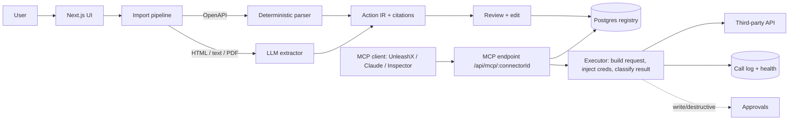

# BYOMCP: product brief

The original brief: context, scope, architecture and build plan, written before the first line of code. What was actually built (and what changed along the way) is in [DECISIONS.md](DECISIONS.md) and [ARCHITECTURE.md](ARCHITECTURE.md).

## 1. TL;DR

- **What:** a web app where a non-technical user brings an app's API documentation and gets a safe, working MCP server for that app in minutes.
- **Context:** built for UnleashX, to be judged end to end: product thinking, design, engineering, and how well every decision can be explained.
- **Why it matters to UnleashX:** their workflow builder and AI employees act through MCP "apps". Their docs list about 80 MCP servers, a workspace shows 30, and the site claims 100 to 200 integrations: the long tail is the gap either way. This tool would let users (or UnleashX's team) cover the rest from docs, without engineers building each connector.
- **Core principle:** **AI at build time, deterministic at runtime.** AI reads the docs once to draft tools. A human reviews them. The live MCP server then runs stored definitions with zero LLM cost per call.

## 2. Background and context

### 2.1 UnleashX (from its public docs)

- AI employees across voice, chat and workflows for sales, support, HR and ops, with human oversight.
- Their docs (docs.unleashx.ai/mcp) show:
  - Every connected service appears in the workflow builder as an **app with an MCP badge**. Connect once, reuse across agents and workflows.
  - Workflow builder: triggers (app event, schedule, form, webhook, manual), steps via Apps (MCP actions), Builder (If/Else, Loop, Delay, Go To Node, HTTP Request, etc.) and Agents.
  - App event triggers **poll every 1, 2, 5 or 10 minutes**.
  - A 401/403 is handled by reconnecting the account and re-approving scopes.
  - Long-tail fallback: call the provider API directly with an HTTP Request node.
  - Auth across their servers is mixed: some refresh OAuth per connection, many take raw API keys or tokens.
- Integrations already covered by MCP in their docs (as of Nov 2026; their docs index lists 84 entries under `/mcp/`, including built-in utilities):
  Google Sheets, Airtable, Gmail, Google Calendar, Google Docs, Google Drive, Google Forms, Google Maps, Google Slides, Brevo, Cal.com, ClickUp, Firebase, HubSpot, SendGrid, Close CRM, Dropbox, Flodesk, GREEN-API, Shopify, Stripe, Slack, WhatsApp Business, WordPress, PDF.co, Webflow, WooCommerce, Zoho CRM, Zoho Desk, Zoho Mail, plus OCR and transcription utilities.

### 2.2 Requirements

- Turn an app's docs into MCP tools: read the docs with an agent, draft the actions, store them so we know how to configure and call them.
- Assume the target app is available: the user already has an account.
- It must work for a **non-technical user**: anyone from a CS associate to an ops person.
- It needs a real **front end**: the design principles matter as much as the plumbing.
- Be **cost-conscious about AI**: use it only where manual work wouldn't do, and show where it's worth its cost and where it isn't.

### 2.3 Why this design answers it

| Concern | How the product answers it |
|---|---|
| Non-tech users | Plain-language wizard, safe defaults, no JSON unless you open "Advanced" |
| AI cost | AI runs once per import; cost shown per connector; runtime uses no LLM |
| Trust / correctness | Every tool shows its evidence: Tested, Sourced (with doc quote) or Needs review |
| Safety | Writes off by default, destructive actions need approval, credentials never reach the LLM |
| Reliability | Call logs, failure reasons, connector health, reconnect prompts |
| Fits their stack | Output is a standard MCP server URL any MCP client can use, including their builder (to confirm) |

## 3. Users and jobs

- **Primary user:** CS associate or ops person at an UnleashX customer (or UnleashX's own solutions team). Comfortable with SaaS tools, not with APIs.
- **Job:** "My AI employee needs to do X in App Y, and App Y isn't in the list. I have their API docs and my account. Make it work, safely, today."
- **Secondary user:** UnleashX's internal team, who could use the same tool to scale their connector catalog.

## 4. Success metrics (what I'll show)

- **Time to first working tool:** docs link to a tested tool call. Target: under 10 minutes.
- **Suggestion acceptance rate:** share of AI-drafted actions accepted without edits.
- **AI build cost per connector** (estimate shown in UI), and **runtime LLM cost: zero**.
- **Tested coverage:** share of enabled actions with at least one successful test call.

## 5. Scope

### Must have (by Saturday morning)

1. Import docs three ways: **OpenAPI/Swagger** (URL or file), **docs page URL** (HTML), **pasted text**.
2. Extraction into a typed intermediate representation (IR) of actions, with source citations.
3. Review screen: plain-language action list, toggles, risk tiers, evidence states, edit names/descriptions, "Advanced" view for method, path and schema.
4. Connect account: API key, bearer token or basic auth. Encrypted at rest.
5. "Try it": run a test call for a read action from the UI; mark it Tested on success.
6. Publish: creates a versioned connector and an MCP endpoint (Streamable HTTP) with its own access token.
7. MCP runtime: exposes enabled actions as tools, executes calls deterministically, injects credentials server-side.
8. Approvals: write actions can require approval; destructive actions always do. Approval inbox in UI.
9. Call log and connector health: status, last success, failures by reason, reconnect prompt.
10. **In-app MCP test console:** a page that acts as an MCP client against the app's own endpoint (initialize, list tools, call a tool, show the raw MCP messages). This is the primary way to test, and it lets an evaluator test without any setup.
11. Two real third-party APIs working end to end (one via OpenAPI, one via HTML docs).
12. Deployed on Vercel. README, architecture diagram, short demo script.

### Should have

- Re-import docs and show a diff (added, changed, removed actions) before publishing a new version.
- AI cost estimate per import in the UI.
- PDF upload.

### Could have

- Generic OAuth 2.0 (authorization code) with user-provided client ID and secret.
- Postman collection import.
- Simple multi-user login.

### Won't have (say so in the README, as v2)

- Event triggers / webhooks (note: UnleashX polls app events every 1-10 minutes; real-time triggers are a natural v2).
- Billing, orgs, multi-tenancy, GraphQL, SOAP.

## 6. Product flow and screens

### 6.1 Wizard: "Add an app"

1. **Bring the docs:** paste a docs link, upload an OpenAPI file, or paste text. Name the app.
2. **Reading the docs:** progress (pages read, actions found), estimated AI cost.
3. **Review actions:** grouped by resource (Contacts, Tickets, Deals). Each row shows:
   - Plain-language name ("Create a ticket"), one-line description.
   - Risk tier badge: Read / Write / Destructive.
   - Evidence state: Tested / Sourced / Needs review, with the doc quote on hover or expand.
   - Toggle (reads on by default, writes off, destructive off).
   - "Advanced" expander: method, path, parameters, JSON schema, editable.
4. **Connect your account:** auth type detected from docs, with a fallback picker. Shows which fields are needed and where to find them in the app.
5. **Try it:** pick a read action, fill parameters, run, see a readable result and the raw response.
6. **Publish:** get the MCP server URL and access token, copy buttons, "Use in UnleashX" and "Test with Claude / MCP Inspector" instructions.

### 6.2 Connector detail

Tabs: Actions, Health, Activity (call log), Versions, Settings (credentials, endpoint token rotate).

### 6.3 Approvals inbox

Pending tool calls with the exact request in plain language ("Create a ticket in Freshdesk with subject …"). Approve or reject. Approve executes and records the result.

### 6.4 Home

Connector list with health status. Empty state invites "Add your first app".

## 7. Architecture



### 7.1 Stack (proposal, confirm before installing)

- Next.js (App Router) + TypeScript, Tailwind, shadcn/ui where it helps.
- Postgres on Neon + Drizzle ORM.
- LLM for extraction behind a small provider interface (`src/server/llm/`). **Gemini by default**, Claude as an optional second provider. Provider and model from env (`LLM_PROVIDER`, `LLM_MODEL`), never hard-coded. Use the provider's JSON-schema structured output mode, and validate everything with Zod. Check the current Gemini SDK and models before building.
- MCP: official TypeScript SDK (`@modelcontextprotocol/sdk`), Streamable HTTP transport. Evaluate Vercel's `mcp-handler` for Next.js route handlers. **Check current versions and the current MCP spec before choosing; don't rely on memory.**
- OpenAPI parsing: a maintained parser that dereferences `$ref`s (check options at build time).
- Deploy on Vercel.

### 7.2 Action IR (the contract between extraction, review and runtime)

```ts
type RiskTier = "read" | "write" | "destructive";
type Evidence = "tested" | "sourced" | "needs_review";

interface ActionIR {
  key: string;              // snake_case, unique per connector, <= 64 chars, [a-z0-9_]
  title: string;            // plain language: "Create a ticket"
  description: string;      // one or two sentences, user-facing and model-facing
  resource: string;         // grouping: "Tickets"
  method: "GET" | "POST" | "PUT" | "PATCH" | "DELETE";
  path: string;             // "/api/v2/tickets/{id}"
  params: {
    path: JSONSchemaObject;
    query: JSONSchemaObject;
    headers: JSONSchemaObject; // non-auth headers only
    body?: JSONSchemaObject;
  };
  successCheck?: { field: string }; // e.g. "id": a 2xx without it is treated as failed
  pagination?: { style: "page" | "cursor" | "offset" | "none"; hint?: string };
  risk: RiskTier;
  evidence: Evidence;
  citation?: { url?: string; quote: string }; // short excerpt from the docs
  confidence: number;       // 0..1 from extractor; deterministic parser = 1
}
```

Risk rules: GET/HEAD = read; POST/PUT/PATCH = write; DELETE, or names like delete/cancel/refund/void/archive = destructive. Map to MCP tool annotations (`readOnlyHint`, `destructiveHint`).

### 7.3 Data model (Drizzle tables)

```
connectors        id, name, slug, base_url, auth_type, status, created_at
connector_versions id, connector_id, version, source_type, source_ref, import_cost_usd, tokens_in, tokens_out, published_at
actions           id, version_id, key, title, description, resource, method, path, params_json,
                  success_check, pagination_json, risk, evidence, citation_json, confidence,
                  enabled, requires_approval
credentials       id, connector_id, type, encrypted_blob, iv, auth_tag, status, last_verified_at
endpoint_tokens   id, connector_id, token_hash, created_at, revoked_at
tool_calls        id, connector_id, action_id, input_json (redacted), status, http_status,
                  failure_reason, duration_ms, response_preview, created_at
approvals         id, tool_call_id, status, decided_at, decided_by
import_jobs       id, connector_id, status, pages_read, actions_found, error, created_at
```

### 7.4 Import pipeline

- **OpenAPI path (deterministic):** parse and dereference, map each operation to `ActionIR`, evidence = sourced, confidence = 1. Optional cheap LLM pass only to write plain-language titles and descriptions (batched, small).
- **HTML / text / PDF path (AI):**
  1. Fetch the URL with an SSRF guard (https only, block private and link-local IPs, size and time limits). Optionally follow same-domain links to API reference pages, capped (e.g. 25 pages).
  2. Convert to clean text/markdown, chunk.
  3. LLM extracts actions per chunk into the IR schema, each with a short citation quote.
  4. Merge and dedupe by method + path. Low-confidence or missing fields = needs_review.
  5. Detect auth type and base URL; ask the user to confirm.
- Log tokens and estimated cost per import (price table in a config constant, labeled as estimate).
- **Treat doc content as untrusted data.** Never follow instructions found in docs. Schema-validate all LLM output.

### 7.5 Runtime executor

1. Authenticate the MCP request by endpoint token (hashed in DB).
2. List tools = enabled actions of the published version, with JSON schemas and annotations.
3. On call: validate input with the schema → if approval required, create approval and return a "pending approval" result with its ID → else build the request (path params, query, body), inject credentials server-side, call with timeout.
4. Classify:
   - 2xx and success check passes → success.
   - 2xx but success check fails or body empty when data expected → `empty_or_invalid`.
   - 401/403 → `auth_failed` → mark credential "needs reconnect".
   - 429/5xx/timeout → retry with backoff (max 2) → `transient_failed`.
   - other 4xx → `request_error` with the API's message.
5. Return a concise result to the client (truncate large bodies), log the call with secrets redacted, update health.

### 7.6 Security

- Credentials: AES-256-GCM with a key from env (`CREDENTIALS_ENCRYPTION_KEY`). Never logged, never sent to the LLM, never returned to the browser after saving.
- Endpoint tokens: random, shown once, stored hashed, rotatable.
- SSRF guard on both doc fetching and runtime calls (base URL must be the confirmed public host).
- App access: single demo workspace behind a passcode (env) for the draft.

## 8. Design brief (for the front end)

- **Audience:** non-technical CS and ops people. Calm, trustworthy, plain language.
- **Primary job of the UI:** get from "I have docs" to "my AI employee can use this app safely" with confidence at every step.
- **Principles:**
  1. Plain language first. "Create a ticket", not `POST /tickets`. API details live under "Advanced".
  2. Show evidence, not confidence. Every action says why we believe it: Tested, Sourced (with the quote) or Needs review.
  3. Safe by default. Reads on, writes off, destructive needs approval. Defaults are visible and explained.
  4. One primary action per screen, named for exactly what it does and kept consistent ("Publish" → "Published").
  5. Errors and empty states tell you what to do next ("Your API key was rejected. Check it's an admin key, then reconnect.").
  6. Cost is visible: what the AI step cost, and that running the connector costs nothing extra.
- **Process (follow the frontend-design approach):** write a compact token plan first (4-6 named colors, type roles, layout concept with ASCII wireframes, principles), check it against the brief, avoid generic AI-design defaults (cream + terracotta, black + acid green, identical rounded cards, ALL-CAPS eyebrows, `→` on every button). Then build. Responsive, keyboard focus visible, reduced motion respected, light and dark.

## 9. Target apps for the demo

Selection criteria:
1. Not in UnleashX's MCP-covered list.
2. Fits an UnleashX use case (sales, support, HR, ops).
3. Free trial or sandbox I can use today, with API key or token auth.
4. One app with an OpenAPI spec (deterministic path), one with HTML-only docs (AI path).

Candidates to verify (docs format, free access, not already covered): Pipedrive, Freshdesk, Zendesk, Intercom, Calendly, Notion, Trello, Typeform, Mailchimp, Razorpay (test mode), Twilio.

Final picks: Zendesk (OpenAPI) and BambooHR (docs page); see DECISIONS.md, slice 6.

## 10. Build plan (vertical slices)

Each slice ends working, committed and deployed.

| When | Slice | Done when |
|---|---|---|
| Thu night | 0. Scaffold | Next.js app on Vercel, Neon DB connected, Drizzle schema migrated, IR types + Zod, passcode gate, design token plan written and reviewed |
| Thu night | 1. OpenAPI import | Upload or URL → actions in DB → basic review list; unit test on a sample spec |
| Fri AM | 2. AI import | Docs URL / pasted text → LLM extraction with citations, dedupe, cost logged; SSRF guard tested |
| Fri midday | 3. Review + connect + Try it | Toggles, risk, evidence, Advanced editor; encrypted credentials; test call marks Tested |
| Fri afternoon | 4. Publish + MCP runtime | Versioned publish, endpoint token, tools listed and callable from (a) the in-app test console, (b) MCP Inspector run locally, (c) an automated test script using the MCP SDK client |
| Fri evening | 5. Safety + reliability | Approvals inbox, result classification, retries, call log, health + reconnect prompt |
| Fri evening | 6. Two real apps | Both demo apps work end to end from the UI |
| Fri late | 7. Polish | Empty/error states, responsive, dark mode, copy pass |
| Sat early | 8. Ship | README, ARCHITECTURE.md with diagram, DECISIONS.md, demo script, final deploy, send email |

Buffer: if behind, cut in this order: PDF upload → re-import diff → cost display → second import path polish. Never cut approvals, credential safety or the MCP runtime.

## 11. Deliverables

- Live URL (passcode protected), GitHub repo link.
- 3-minute walkthrough (screen recording) following the demo script.
- README: problem, who it's for, how to use, key decisions, what's next (v2: triggers, OAuth, catalog sharing across customers).
- DECISIONS.md: AI at build time vs runtime, evidence states, risk tiers, why a generic runtime instead of generating code per connector.

## 12. Demo script (3 minutes)

1. Problem (20s): AI employees need apps; ~32 of 100+ have MCP; each new connector is engineering work.
2. Add an app from docs (60s): paste link → actions found with evidence → AI cost shown.
3. Review and connect (40s): safe defaults, approval on writes, connect API key, Try it → Tested.
4. Publish and use (40s): MCP URL → call from Claude/Inspector → write action lands in Approvals → approve → done.
5. Health (20s): break the key → auth_failed → "Needs reconnect" shown → reconnect.

## 13. Decisions log (keep updating)

- Generic runtime reading stored definitions, not generated code per connector: easier to review, version, secure and update.
- AI only where input varies and output is verifiable (docs extraction). Deterministic where possible (OpenAPI, runtime).
- Evidence states mirror how I tag claims in my OAuth guides: tested, sourced, unverified.

## 14. Open questions / assumptions

- Can UnleashX's builder add an external MCP server by URL? Assumed yes (standard Streamable HTTP); to confirm with UnleashX.
- Is the user always the customer, or also UnleashX's internal team? Designed for both.
- Should connectors built by one customer be shareable to others (catalog growth)? Out of scope, noted as v2.

## 15. Constraints

- Built from scratch.
- No real customer data. Use my own trial accounts.
- Project-owned accounts and keys for everything (GitHub, Vercel, Neon, Gemini API key).
- Test with the in-app console, MCP Inspector (`npx @modelcontextprotocol/inspector`, check current usage), and SDK-based integration tests. For the demo video, optionally add the deployed URL as a custom connector on a personal Claude account.
